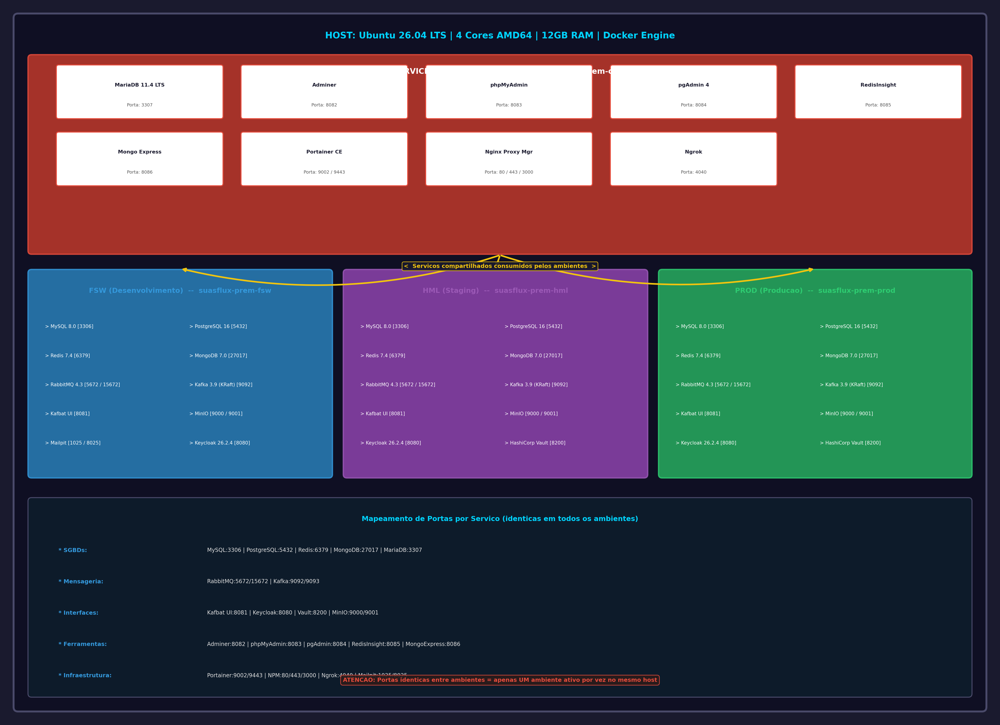

# SUAFLUX PREM - Infraestrutura On-Premise Multi-Ambiente

## Visao Geral

Este repositorio contem a infraestrutura completa containerizada para a plataforma **SuasFlux**, projetada para operar em ambiente **on-premise** com arquitetura que suporta tanto **monolito modular** quanto **microsservicos**.

A solucao foi construida sobre **Docker Compose** com separacao clara de ambientes, redes isoladas, health checks, limites de recursos e padronizacao de operacoes via **Makefile**.

---

## Especificacoes do Host

| Recurso         | Especificacao                          |
|-----------------|----------------------------------------|
| Sistema Operacional | Ubuntu 26.04 LTS (64 bits)         |
| Processador     | Minimo 4 nucleos (AMD64 / x64)         |
| Memoria RAM     | 12GB                                   |
| Docker          | Ja instalado (Docker Engine + Compose) |
| Diretorio Base  | `infra-prem/`                          |

---

## Arquitetura



### Descricao da Arquitetura

A infraestrutura e organizada em **4 ambientes isolados por redes Docker**, onde os ambientes de aplicacao (FSW, HML, PROD) consomem servicos compartilhados do ambiente COMMON:

```
+------------------------------------------------------------------+
|                         HOST UBUNTU 26.04                         |
|                    4 Cores AMD64 | 12GB RAM                       |
+------------------------------------------------------------------+
|                                                                   |
|  +------------------------+    +-------------------------------+   |
|  |  COMMON (Shared Svcs)  |    |  FSW  |  HML  |  PROD       |   |
|  |  suasflux-prem-common  |<---|-------|-------|------------>|   |
|  +------------------------+    +-------------------------------+   |
|                                                                   |
|  Servicos:                     Ambientes de Aplicacao:           |
|  - MariaDB 11.4 LTS            - MySQL 8.0                       |
|  - Adminer                     - PostgreSQL 16                     |
|  - phpMyAdmin                  - Redis 7.4                       |
|  - pgAdmin 4                   - MongoDB 7.0                     |
|  - RedisInsight                - RabbitMQ 4.3 + Management       |
|  - Mongo Express               - Apache Kafka 3.9 (KRaft)        |
|  - Portainer CE                - Kafbat UI                         |
|  - Nginx Proxy Manager         - MinIO + Console                   |
|  - Ngrok                       - Keycloak 26.2.4                  |
|                                - HashiCorp Vault (HML/PROD)        |
|                                - Mailpit (FSW) / SendGrid API      |
+------------------------------------------------------------------+
```

### Principios Arquiteturais

1. **Isolamento por Rede**: Cada ambiente possui sua propria rede Docker bridge
2. **Servicos Compartilhados**: COMMON prove ferramentas de gerenciamento transversais
3. **Portas Padronizadas**: Mesmas portas em todos os ambientes (mutuamente exclusivos no mesmo host)
4. **Persistencia**: Todos os dados sao mantidos em volumes Docker nomeados
5. **Observabilidade**: Health checks em todos os servicos criticos
6. **Governanca de Recursos**: Limites de CPU e memoria definidos por container

---

## Estrutura de Diretorios

```
infra-prem/
|-- README.md                      # Este arquivo
|-- Makefile                       # Automacao de operacoes
|-- .env.common                    # Variaveis do ambiente COMMON
|-- .env.fsw                       # Variaveis do ambiente FSW
|-- .env.hml                       # Variaveis do ambiente HML
|-- .env.prod                      # Variaveis do ambiente PROD
|-- docker-compose.common.yml      # Compose - Shared Services
|-- docker-compose.fsw.yml         # Compose - Desenvolvimento
|-- docker-compose.hml.yml         # Compose - Staging
|-- docker-compose.prod.yml        # Compose - Producao
|-- docs/
|   -- arquitetura.png              # Diagrama arquitetural
```

---

## Ambientes

### 1. COMMON (Shared Services)
Servicos compartilhados consumidos por todos os ambientes de aplicacao.

| Servico              | Imagem Docker                          | Porta(s) Host    | Funcao                          |
|----------------------|----------------------------------------|------------------|---------------------------------|
| MariaDB              | `mariadb:11.4`                         | 3307             | SGBD compartilhado              |
| Adminer              | `adminer:latest`                       | 8082             | UI generica para SGBDs          |
| phpMyAdmin           | `phpmyadmin:latest`                    | 8083             | UI para MySQL/MariaDB           |
| pgAdmin 4            | `dpage/pgadmin4:latest`                | 8084             | UI para PostgreSQL              |
| RedisInsight         | `redis/redisinsight:latest`            | 8085             | UI para Redis                   |
| Mongo Express        | `mongo-express:latest`                 | 8086             | UI para MongoDB                 |
| Portainer CE         | `portainer/portainer-ce:2.27.0`        | 9002 / 9443      | Orquestracao de containers      |
| Nginx Proxy Manager  | `jc21/nginx-proxy-manager:latest`      | 80 / 443 / 3000  | Proxy reverso dinamico          |
| Ngrok                | `ngrok/ngrok:latest`                   | 4040             | Tunelamento externo             |

### 2. FSW (Desenvolvimento)
Ambiente completo para desenvolvimento local.

| Servico              | Imagem Docker                          | Porta(s) Host    | Funcao                          |
|----------------------|----------------------------------------|------------------|---------------------------------|
| MySQL                | `mysql:8.0`                             | 3306             | SGBD relacional                 |
| PostgreSQL           | `postgres:16.4`                        | 5432             | SGBD relacional avancado        |
| Redis                | `redis:7.4`                             | 6379             | Cache/Store chave-valor         |
| MongoDB              | `mongo:7.0`                             | 27017            | SGBD NoSQL documental           |
| RabbitMQ             | `rabbitmq:4.3.4-management`             | 5672 / 15672     | Broker de mensagens             |
| Kafka                | `apache/kafka:3.9.0`                    | 9092 / 9093      | Streaming de eventos (KRaft)  |
| Kafbat UI            | `kafbat/kafka-ui:latest`               | 8081             | Interface grafica do Kafka      |
| MinIO                | `minio/minio:latest`                   | 9000 / 9001      | Object Storage S3-compatible    |
| Mailpit              | `axllent/mailpit:latest`               | 1025 / 8025      | SMTP catcher para testes        |
| Keycloak             | `quay.io/keycloak/keycloak:26.2.4`     | 8080             | Identity Provider (modo dev)    |

### 3. HML (Staging)
Ambiente de homologacao, espelho da producao.

Inclui todos os servicos do FSW **exceto Mailpit**, adicionando:

| Servico              | Imagem Docker                          | Porta(s) Host    | Funcao                          |
|----------------------|----------------------------------------|------------------|---------------------------------|
| HashiCorp Vault      | `hashicorp/vault:latest`               | 8200             | Cofre de segredos               |

**Email**: SendGrid Web API (servico externo, sem container).

### 4. PROD (Producao)
Ambiente de producao.

Identico ao HML em estrutura de servicos, com Keycloak em modo producao (`start --optimized`).

---

## Mapeamento Completo de Portas

| Servico              | Porta Host | Ambientes Presente                |
|----------------------|------------|-----------------------------------|
| MySQL                | 3306       | FSW, HML, PROD                    |
| MariaDB              | 3307       | COMMON                            |
| PostgreSQL           | 5432       | FSW, HML, PROD                    |
| Redis                | 6379       | FSW, HML, PROD                    |
| MongoDB              | 27017      | FSW, HML, PROD                    |
| RabbitMQ AMQP        | 5672       | FSW, HML, PROD                    |
| RabbitMQ Management  | 15672      | FSW, HML, PROD                    |
| Kafka                | 9092       | FSW, HML, PROD                    |
| Kafka Controller     | 9093       | FSW, HML, PROD                    |
| Kafbat UI            | 8081       | FSW, HML, PROD                    |
| Keycloak             | 8080       | FSW, HML, PROD                    |
| Vault                | 8200       | HML, PROD                         |
| MinIO API            | 9000       | FSW, HML, PROD                    |
| MinIO Console        | 9001       | FSW, HML, PROD                    |
| Mailpit SMTP         | 1025       | FSW                               |
| Mailpit Web          | 8025       | FSW                               |
| Adminer              | 8082       | COMMON                            |
| phpMyAdmin           | 8083       | COMMON                            |
| pgAdmin              | 8084       | COMMON                            |
| RedisInsight         | 8085       | COMMON                            |
| Mongo Express        | 8086       | COMMON                            |
| Portainer HTTP       | 9002       | COMMON                            |
| Portainer HTTPS      | 9443       | COMMON                            |
| NPM HTTP             | 80         | COMMON                            |
| NPM HTTPS            | 443        | COMMON                            |
| NPM Admin            | 3000       | COMMON                            |
| Ngrok                | 4040       | COMMON                            |

---

## Primeiros Passos

### 1. Clonar/Extrair o Projeto

```bash
cd infra-prem/
```

### 2. Configurar Variaveis de Ambiente

Edite os arquivos `.env.*` conforme necessario. **Altere todas as senhas padrao antes de usar em producao!**

### 3. Criar as Redes Docker

```bash
make networks-up
```

Ou manualmente:
```bash
docker network create suasflux-prem-common
docker network create suasflux-prem-fsw
docker network create suasflux-prem-hml
docker network create suasflux-prem-prod
```

### 4. Subir os Ambientes

**Shared Services (obrigatorio primeiro):**
```bash
make common-up
```

**Desenvolvimento:**
```bash
make fsw-up
```

**Staging:**
```bash
make hml-up
```

**Producao:**
```bash
make prod-up
```

**Todos de uma vez (requer recursos suficientes):**
```bash
make all-up
```

**PARA TODOS OS CONTAINERS COM EXCEÇÃO DOS LISTADOS:**
```bash
docker stop $(docker ps -q | grep -v -e e177131b103e -e efff9187a771)
```

### 5. Verificar Status

```bash
make all-ps
```

### 6. Visualizar Logs

```bash
make fsw-logs      # ou common-logs, hml-logs, prod-logs
```

---

## Comandos do Makefile

| Comando           | Descricao                                      |
|-------------------|------------------------------------------------|
| `make help`       | Exibe ajuda com todos os comandos              |
| `make networks-up`| Cria as 4 redes Docker                         |
| `make common-up`  | Sobe Shared Services                           |
| `make common-down`| Derruba Shared Services                        |
| `make fsw-up`     | Sobe ambiente de Desenvolvimento               |
| `make fsw-down`   | Derruba ambiente de Desenvolvimento            |
| `make hml-up`     | Sobe ambiente de Staging                       |
| `make hml-down`   | Derruba ambiente de Staging                    |
| `make prod-up`    | Sobe ambiente de Producao                      |
| `make prod-down`  | Derruba ambiente de Producao                   |
| `make all-up`     | Sobe todos os ambientes                        |
| `make all-down`   | Derruba todos os ambientes                     |
| `make all-ps`     | Status de todos os containers                  |
| `make backup`     | Backup dos volumes criticos                    |
| `make clean`      | Limpa recursos Docker nao utilizados           |

**Força a listagem e exclusão de todos os volumes na marra (requer contêineres parados):** 
```bash
docker volume rm $(docker volume ls -q) --force
```

**Remover todos os recursos não utilizados do Docker e liberar espaço em disco.:**
```bash
docker system prune --all
```

---

## Consideracoes Importantes

### 1. Nginx Proxy Manager e MariaDB

O usuario solicitou que o **Nginx Proxy Manager (NPM)** utilizasse **MariaDB** como backend. No entanto, a imagem oficial `jc21/nginx-proxy-manager` utiliza **SQLite** internamente como unico backend suportado. Nao ha versao oficial com suporte a MySQL/MariaDB.

**Solucao implementada**: O NPM utiliza seu SQLite interno com volume persistente (`npm_data`). O MariaDB do ambiente COMMON esta disponivel para outros usos (ex: aplicacoes que necessitem de um SGBD relacional compartilhado).

### 2. Versao do Keycloak

O usuario solicitou **Keycloak 26.6.4**. Esta versao **nao existe** no momento da elaboracao deste documento (Julho/2026). A versao mais recente estavel disponivel e a **26.2.4**, que foi utilizada.

Para atualizar futuramente, altere a tag da imagem em todos os arquivos `docker-compose.*.yml`.

### 3. SendGrid

O **SendGrid Web API** e um servico SaaS externo da Twilio. Nao existe imagem Docker oficial. Em HML e PROD, o envio de e-mails deve ser implementado via integracao direta com a API do SendGrid utilizando a chave configurada no `.env.hml` / `.env.prod`.

### 4. Portas Identicas entre Ambientes

As portas dos servicos sao **identicas** em FSW, HML e PROD. Isso significa que **apenas um ambiente pode estar ativo por vez** no mesmo host fisico. Para rodar multiplos ambientes simultaneamente, seria necessario alterar as portas no `.env` ou utilizar hosts diferentes.

Esta decisao foi tomada para manter a consistencia de configuracao entre ambientes, facilitando a migracao de aplicacoes.

### 5. Kafka em Modo KRaft

O Apache Kafka esta configurado em modo **KRaft** (Kafka Raft), eliminando a dependencia do ZooKeeper. Isso simplifica a operacao e reduz o consumo de recursos.

### 6. Timezone

Todos os containers estao configurados com `TZ=America/Recife` conforme solicitado.

### 7. Limites de Recursos

Os limites de CPU e memoria foram definidos considerando o host de **4 cores / 12GB RAM**. A soma dos limits de um ambiente completo (ex: PROD) e de aproximadamente **8-9GB RAM** e **3-4 cores**, permitindo rodar o COMMON + um ambiente de aplicacao confortavelmente.

---

## Health Checks

Todos os servicos criticos possuem health checks configurados:

| Servico      | Tipo de Check                                    |
|--------------|--------------------------------------------------|
| MariaDB      | `healthcheck.sh --connect --innodb_initialized`  |
| MySQL        | `mysqladmin ping`                                |
| PostgreSQL   | `pg_isready`                                     |
| Redis        | `redis-cli incr ping`                            |
| MongoDB      | `db.runCommand({ping: 1})` via mongosh           |
| RabbitMQ     | `rabbitmq-diagnostics ping`                      |
| Kafka        | `kafka-broker-api-versions.sh`                 |
| MinIO        | `curl /minio/health/live`                      |
| Keycloak     | Dependencia do MySQL (condicao service_healthy)  |
| Vault        | `vault status`                                   |

---

## Backup e Restore

### Backup Automatico

```bash
make backup
```

Cria snapshots `.tar.gz` de todos os volumes criticos no diretorio `backups/YYYYMMDD_HHMMSS/`.

### Backup Manual (exemplo MySQL FSW)

```bash
docker exec mysql-suasflux-prem-fsw mysqldump -u root -pSuasFlux@MySQLRoot#2026 --all-databases > backup_mysql_fsw.sql
```

### Restore Manual

```bash
docker exec -i mysql-suasflux-prem-fsw mysql -u root -pSuasFlux@MySQLRoot#2026 < backup_mysql_fsw.sql
```

---

## Troubleshooting

### Erro "network not found"

Certifique-se de criar as redes antes de subir os ambientes:
```bash
make networks-up
```

### Erro de porta ja em uso

Verifique se outro ambiente esta rodando:
```bash
docker ps
```

Se necessario, derrube o ambiente anterior:
```bash
make all-down
```

### Keycloak nao inicia

Verifique se o MySQL esta healthy:
```bash
docker ps --filter health=unhealthy
```

### Vault em modo dev

Em HML e PROD, o Vault esta em modo desenvolvedor (`-dev`). **Nao utilize em producao real sem configurar um backend persistente adequado (Consul, Raft, etc.) e TLS.**

---

## Seguranca

1. **Altere todas as senhas padrao** nos arquivos `.env.*` antes de colocar em producao
2. **Habilite firewall (UFW)** no host Ubuntu para restringir acesso as portas
3. **Configure TLS** no Nginx Proxy Manager para acesso externo
4. **Rode Vault em modo server** (nao dev) com backend Raft em producao real
5. **Restrinja acesso ao Docker socket** (Portainer)
6. **Rotacione credenciais** do SendGrid regularmente

---

## Licenca

Infraestrutura proprietaria SuasFlux. Uso interno autorizado.

---

## Changelog

| Versao | Data       | Descricao                          |
|--------|------------|-------------------------------------|
| 1.0.0  | 2026-07-27 | Setup inicial multi-ambiente        |
